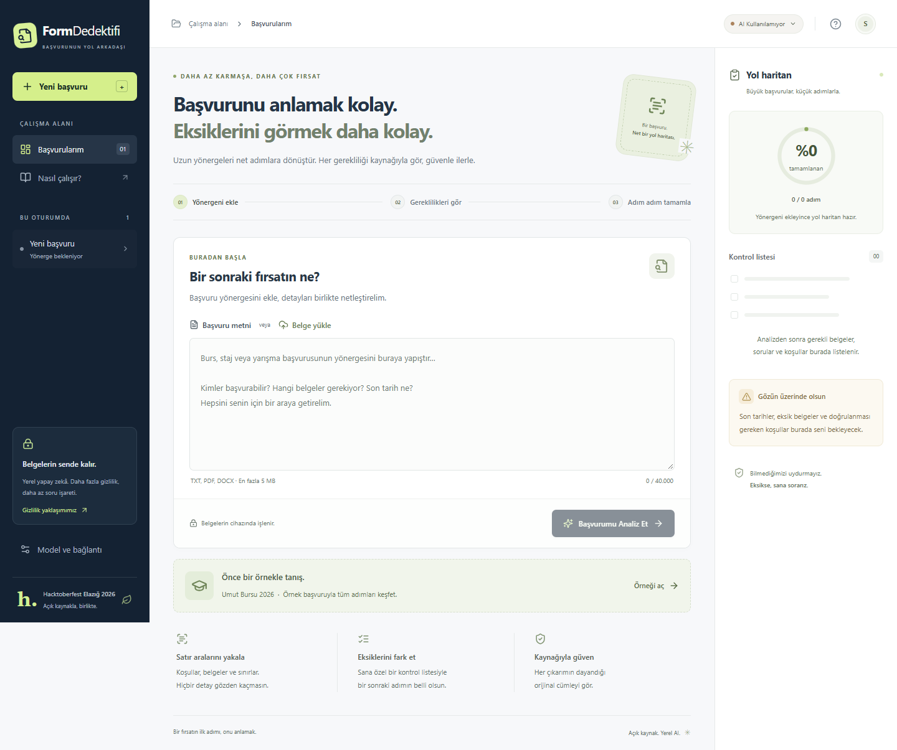

# Doğrulama kaydı

## Alt alta form soruları — 18 Ekim 2026

Soru seçme menüsü kaldırıldı. Yanıt asistanı tüm soruları numaralı kartlar halinde aynı sayfada gösteriyor. Her kartın kendine ait bilgi alanı, taslak düğmesi, düzenlenebilir yanıtı, karakter sayacı, kopyalama düğmesi ve önerileri var. Yanıtlar ve öneriler başvuru/soru bazında korunuyor. Bir yanıt üretilirken başka kartta yapılan düzenlemeler kaybolmuyor; bekleme göstergesi yalnızca işlenen soruda çıkıyor. Genel bakıştaki soru oku ilgili karta kaydırıp odaklıyor.

Üretim derlemesi, **8 Vitest testi ve 14 masaüstü/mobil Playwright senaryosu** geçti. Yeni kontroller bütün kartların alt alta görünmesini, bağımsız cevap ve önerileri, istek sürerken diğer yanıttaki düzenlemelerin korunmasını ve doğru karta odaklanmayı doğruluyor. İlk tarayıcı çalıştırmasında kaldırılan menüyü denetleyen kontrol yanlışlıkla sağ paneldeki durum menülerini de saydı; kontrol yanıt asistanına daraltıldı ve etkilenen iki senaryo tekrar çalıştırılıp geçti.

Gerçek Chrome/Gemma kontrolünde üç kart birlikte gösterildi; ikinci soruya (`goals`) **HTTP 200, mode=live, 257 karakterlik yanıt** üretildi. İlk kartın elle yazılan yanıtının korunduğu ve üçüncü kartın boş kaldığı doğrulandı. Tanı numarası `2ed77295ad2c`; ekran kaydı `.tools/logs/questions-stacked.png`. Backend değişmedi.

## Rastgele örnek başvurular — 18 Ekim 2026

13 kurgusal başvuru eklendi: burs, yazılım stajı, yapay zekâ hackathonu, gönüllülük, girişimcilik, araştırma, sürdürülebilirlik, tasarım, açık kaynak, kültürel değişim, mentorluk, sosyal proje ve yaratıcı yazarlık. Her örnekte üç form sorusu, karakter sınırları, belge/uygunluk koşulları, gönderim ve son tarih bulunuyor. Örnekler gerçek ilan değildir.

`Örnek ekle` düğmesi her tıklamada mevcut örnek dışından rastgele seçim yapıyor ve analiz sonrasında da görünür kalıyor. Yeni örnek önceki analiz, cevaplar ve işaretlemeleri temizliyor. Demo her soruya ait ayrı örnek cevap gösteriyor; gerçek Gemma seçeneği varsayılan olarak açık kalıyor. Katalog hem frontend hem backend tarafından ortak JSON dosyalarından okunuyor; özel belgeler hazır demo sonucu ile ikame edilmiyor.

**88 pytest testi, 8 Vitest testi ve 12 Playwright senaryosu geçti.** Üretim derlemesi başarılı. Katalogdaki tüm örneklerin kaynak kanıtları ve toplam 39 sorunun demo yanıtları doğrulandı. Masaüstü/mobil tarayıcı testi örneği analiz ettikten sonra değiştirmeyi, üç soru görünmesini ve farklı sorularda farklı cevaplar oluşmasını kapsıyor. İki proje kopyası eşitlendi.

## Özel PDF analizi ve çalışan servis logları — 18 Ekim 2026

Kullanıcı hatasında `/api/documents` HTTP 200 ile dosyayı okuyordu; `/api/analyze`, model alıntılarının kaynak doğrulamasından geçmemesi nedeniyle HTTP 502 dönüyordu. `FormAnalizer` başlatıcısı üst klasördeki servisi kullanırken kendi eski test loglarını gösteriyordu.

Analiz artık `ReferencedAnalysis` şemasıyla numaralı özgün bölümleri seçtiriyor; alıntılar modelin yeniden yazdığı metinden alınmıyor. PDF satır sonları ve bölünmez boşlukları korunuyor. Geçersiz bölüm numarası reddediliyor. Seçilen alıntıdaki tek açık karakter sınırı tamamlanıyor; tam gün/ay/yıl, saat ve Türkiye/UTC+3 bilgisi varsa kesin tarih çıkarılıyor. Açık bir son başvuru tarihi model tarafından atlanırsa kaynağıyla tamamlanıyor; eksik veya çok anlamlı tarih/saatten kesin tarih türetilmiyor. Analiz sırasında sağlık kontrolü yeni model üretimi başlatmıyor.

**75 pytest testi, 6 Vitest testi ve 10 masaüstü/mobil Playwright senaryosu geçti**; üretim derlemesi ve PowerShell sözdizimi kontrolü başarılı. Testler gerçek PDF/DOCX ayrıştırmayı, satır kırılmalarını, kaynak referanslarını, hatalı referanstan kurtarmayı ve açık/eksik tarih kurallarını kapsıyor. Pytest'te önceki başarısızlığa yol açmayan Starlette/httpx kullanımdan kaldırma uyarısı devam ediyor.

Gerçek Chrome oturumunda oluşturduğumuz Türkçe PDF, hazır demo kullanılmadan yüklendi ve kurulu `gemma4:e2b` tarafından analiz edildi. İlk gerçek kontrol `/api/documents` HTTP 200, `/api/analyze` HTTP 200, `mode=live`, üç gereklilik ve tüm alıntıların özgün PDF metninde bulunduğunu doğruladı; analiz yaklaşık 8 saniye sürdü (`3136c7ac67b8`). Bu kontrol, kullanıcının paylaşılmamış PDF dosyasını analiz ettiğimiz anlamına gelmez.

Son sürümde aynı gerçek Chrome kontrolü tekrarlandı (`bfab2d7a261d`): PDF yükleme ve analiz HTTP 200 döndü. Güncel özgeçmiş belgesi, 400 karakterlik motivasyon sorusu ve `2026-11-30T17:00:00+03:00` son tarihi kontrol listesinde bulundu. Yanıt asistanındaki gerçek Gemma düğmesinin açıldığı da doğrulandı. Ekran kaydı `.tools/logs/custom-pdf-analysis.png`.

`/api/runtime` çalışan backend'in klasörünü bildiriyor; başlatıcı o klasördeki logları izliyor. Windows PowerShell 5'te Türkçe yol UTF-8 olarak çözümlendi; iki güncel backend log akışı açılarak doğrulandı. Eski `ONCEKI` satırları ve başka çalıştırmadan kalan Ollama port hataları yeni açılışa taşınmıyor.

## Yeni paragraf üreten yanıt akışı — 18 Ekim 2026

Önceki alıntı seçimi ve boş şablon yaklaşımı kaldırıldı. Canlı uç nokta artık `GeneratedDraft` şemasıyla gerçek yanıt metni alıyor; bilgi alanı boşken genel bir paragraf, bilgi verilmişse bu bilgilere göre bir yanıt yazdırıyor. Örnek analizde dahi gerçek taslak üretimi varsayılan olarak açık. Açıkça seçilen demo hazır bir örnek gösteriyor; canlı model hatası demoyla gizlenmiyor.

API testleri boş/dolu bilgiyle yeni metin üretimini, isteğe bağlı önerileri, yer tutucuların reddedilip yeniden üretilmesini, dayanak alıntılarını ve karakter sınırını kapsıyor. Dayanak alıntılarının doğrulanması tüm paragrafın anlamsal doğruluk garantisi değildir. Aşağıdaki 17 Ekim kayıtları önceki sürümlerin tarihsel sonuçlarıdır; alıntıların birleştirildiği kontroller yeni paragraf üretimini kanıtlamaz.

Son doğrulama: **55 pytest, 6 Vitest ve 10 Playwright senaryosu geçti**; TypeScript ve üretim derlemesi başarılı. Gerçek `gemma4:e2b` testi boş bilgiyle yeni genel yanıt, kısa kişisel bilgiyle 223 karakterlik yeni paragraf üretti. İlk uzun istemde yer tutucu ve geçersiz dayanak görüldü; istem sadeleştirildi ve boş bilgi için şemada dayanak listesi sıfırla sınırlandı. Modelden gelen yer tutucu doğrudan gösterilmiyor, yeniden üretim isteniyor.

Son uçtan uca kontrol, yeni Chrome oturumunda bilgi alanı boş bırakılarak **Gemma 4 ile taslak oluştur** düğmesine basılarak yapıldı. Yanıt taklit edilmedi: `/api/draft` HTTP 200, `mode=live`, `method=generated`, `generic=true`; **316 karakterlik gerçek paragraf** düzenlenebilir yanıt alanında gösterildi. Üç ek soru yanıtın altında ayrı öneriler olarak kaldı. Tanı numarası `79ea82265cef`; yerel ekran kaydı `.tools/logs/live-generated-answer.png`.

## Son tanı ve canlı Gemma doğrulaması — 17 Ekim 2026

Son çalışmada **52 pytest testi, 6 Vitest testi ve 8 Playwright tarayıcı senaryosu** çalıştırılıp geçti. TypeScript kontrolü ve üretim derlemesi de başarılı. Masaüstü/mobil kontrolleri model teşhisini, canlı taslak seçimini, hata tanı numarasını ve otomatik erişilebilirlik denetimini kapsıyor.

Taslak oluşturma artık eksik bilgi sorularıyla durdurulmuyor. Mevcut beyan taslakta korunuyor, sorular yanıt alanının altında isteğe bağlı öneriler olarak gösteriliyor. Model yalnızca soru döndürdüğünde mevcut beyanın yine taslağa dönüştüğü API seviyesinde doğrulandı. Boş bilgiyle doldurulabilir alan, tek satırlık bilgiyle taslak ve karakter sınırını aşan bilgiden sınıra uygun taslak üretimi de kapsanıyor.

Güncellenmiş backend ile gerçek `gemma4:e2b` çağrısında tek cümlelik örnek beyan kullanıldı: `/api/draft` **HTTP 200, mode=live, 37 karakterlik taslak ve üç isteğe bağlı öneri sorusu** döndürdü. Yanıtın kullanıcı beyanında birebir bulunduğu doğrulandı. Dosya eşitlemesi sırasında geliştirme sunucusunun yenilediği iki erişilebilirlik senaryosu, eşitleme bittikten sonra tekrar çalıştırılıp geçti.

Bu bilgisayarda Ollama **0.40.5** ve **`gemma4:e2b`** bulundu. `/api/show` yanıtındaki `gemma4` mimarisi ve yerel model doğrulandı. Uygulamanın önceki `.env` etiketi `gemma4:e4b` olduğu için kurulu model seçilemiyordu. İki yerel kopyanın ayarı açıkça E2B'ye değiştirildi.

Gerçek FastAPI `/api/status` isteği `connected`, `model=gemma4:e2b`, `api_key_required=false` döndürdü. Ardından gerçek `/api/draft` isteği, örnek olarak verilen eğitim hedefi ve burs kullanım bilgisiyle **HTTP 200, mode=live, 297 karakter, boş takip sorusu listesi** döndürdü. Bu son kontrol model yanıtı taklit edilmeden yapıldı. Bir önceki daha az ayrıntılı beyanla model ek soru sordu; bu durum başarısızlık olarak gizlenmedi.

Kısa sağlık yanıtının düşünme tokenları nedeniyle boş kalması `think:false` ile giderildi. Sağlık kontrolü ve taslak bağlamı eşitlendi; paralel sağlık kontrollerinin iki kullanıcı üretim slotunu doldurması engellendi. Yapılandırılmış logların kişisel bilgi ve rastgele kullanıcı alan adı içermediği test edildi. HTTP hata yanıtları ve CMD kayıtları aynı tanı numarasıyla eşleştiriliyor.

Aşağıdaki ilk geliştirme kayıtları tarihseldir; ilk oturumda model bulunmuyordu. Yukarıdaki gerçek E2B çıkarımı bu önceki sınırlamayı günceller. OCR, alıntıların anlamsal doğruluğu ve kalıcı oturum saklama sınırları devam eder.

17 Ekim 2026 tarihinde Windows ortamında çalıştırıldı. Yerel geliştirme araçları: Node.js 22.20.0, npm 10.9.3, Python 3.12.10, kurulu Google Chrome. Projeye özel taşınabilir araçlar `.tools/` içindedir ve kaynak dağıtımının parçası değildir.

| Kontrol | Sonuç |
| --- | --- |
| `npm ci` | Kilit dosyasından temiz kurulum başarılı |
| `npm run build` | TypeScript kontrolü ve Vite üretim derlemesi başarılı |
| `npm test` | 6 test geçti |
| `python -m pytest` | 39 test geçti |
| `npm run test:e2e` | 6 senaryo geçti: masaüstü ve mobil Chrome |
| Axe otomatik kontrolleri | Açılış ve dört analiz sekmesinde WCAG 2 A/AA ve 2.1 AA etiketli kurallar için ihlal bulunmadı |
| `npm audit --audit-level=moderate` | 0 açık bildirildi |
| Gerçek yerel HTTP isteği | FastAPI `/api/status` → `unavailable`; `/api/analyze` açık demo isteği → 9 gereklilik |
| Windows başlatıcı | PowerShell sözdizimi geçerli; `scripts/start.ps1 -Demo` yerel Vite sunucusunu başlattı; HTTP 200 alındı |

Tarayıcı senaryoları: örnek yönergeyi açma, açık demo etiketi, birebir kaynak alıntısı, kontrol listesi yüzdesi, kişisel beyan, takip soruları, yalnızca verilen satırlardan taslak, 500 karakter sınırı uyarısı, veri temizleme, oturum ayrımı, özel belgenin demo sonuçlarıyla ikame edilmemesi, yatay taşma ve yakalanmamış JavaScript hatası kontrolü. Ek erişilebilirlik senaryosu metin kontrastını ve otomatik WCAG kurallarını denetler. Bu denetim, tüm engelli kullanıcı deneyimleri için sertifika veya tam manuel erişilebilirlik denetimi değildir.

Backend testleri gerçek TXT/PDF/DOCX ayrıştırıcılarını çalıştırır. Canlı AI servis testlerinde model yanıtı taklit edilir; Gemma 4 çıktısının kalite veya hız ölçümü değildir.

Pytest sonucunda bir **başarısızlığa neden olmayan Starlette TestClient/httpx kullanımdan kaldırma uyarısı** alındı. Model gerektiren canlı analiz, eksik bilgi ve taslak akışının gerçek Ollama çıkarımı bu makinede doğrulanmadı: Ollama kurulu değildi. Uygulama bu durumda modelin bağlı olduğunu iddia etmez.

`gemma4:e4b` desteği resmî Ollama kataloğunda doğrulanmıştır; kurulum ve gerçek yanıt doğrulaması için README adımlarını uygulayın. Kesin bir minimum Ollama sürümü tahmin edilmemiştir. Güncel kararlı sürümle model indirilemiyorsa demo kullanılabilir; başka modele otomatik geçilmez.

Kalan ürün sınırları: yalnızca oturum belleğinde başvuru saklama, OCR bulunmaması, DOCX üstbilgi/dipnot/metin kutularının kapsam dışında olması, alıntı doğrulamasının anlamsal doğruluğu garanti etmemesi ve yanıtların güvenilirlik amacıyla kullanıcı ifadelerinden seçilip sıralanması. Başvuru gönderimi, belge doğrulaması ve otomatik uygunluk onayı yoktur. Ayrıntılar README'dedir.

## BAT kurucu ve başlatıcı kontrolleri

`installer.bat` ve `run.bat`, 17 Ekim 2026 tarihinde ayrıca doğrulandı:

- Türkçe ve boşluk içeren ayrı klasörde Node.js 22 LTS otomatik indirildi, SHA256 kontrolü geçti ve bağımlılıklar kuruldu.
- Mevcut sistem Python'u için sanal ortam kurulumu ve sistem Python'u PATH'ten kaldırıldığında Python 3.13.16 embeddable indirmesi/pip kurulumu ayrı ayrı başarıyla çalıştı.
- Her iki kurulumda üretim derlemesi geçti. Tekrarlanan kurulum, özelleştirilmiş `.env` dosyasının SHA256 değerini değiştirmedi.
- Yeni indirilen Node.js 22.23.3 ve Python 3.13.16 ile `run.bat -NoBrowser -SmokeTest`, backend ve frontend HTTP yanıtlarını alıp kendi servislerini kapattı.
- Ana klasörde ve `FormAnalizer` Git kopyasında bağımlılık kontrolü ve başlatma kontrolü geçti. Zaten çalışan arayüz kullanıldı; eksik backend başlatıldı. İkinci başlatıcı ek servis açmadı.
- Bu testlerde `-Demo` kullanılarak büyük Ollama/Gemma 4 indirmesi atlandı. Tam AI indirme ve gerçek çıkarım yolu bu doğrulama kapsamına dahil değildir.
